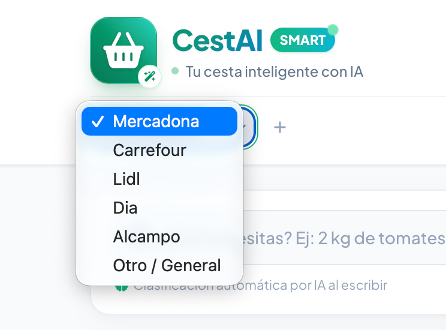
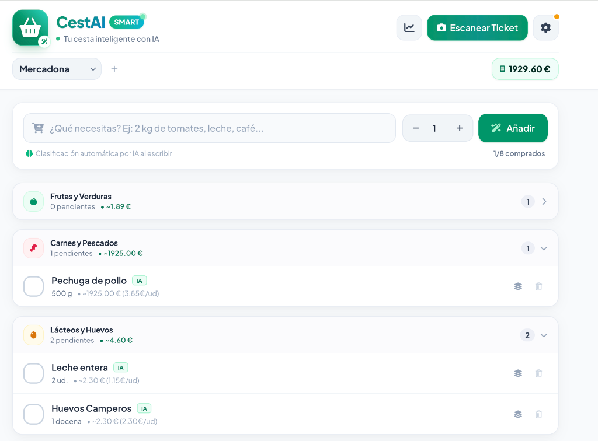
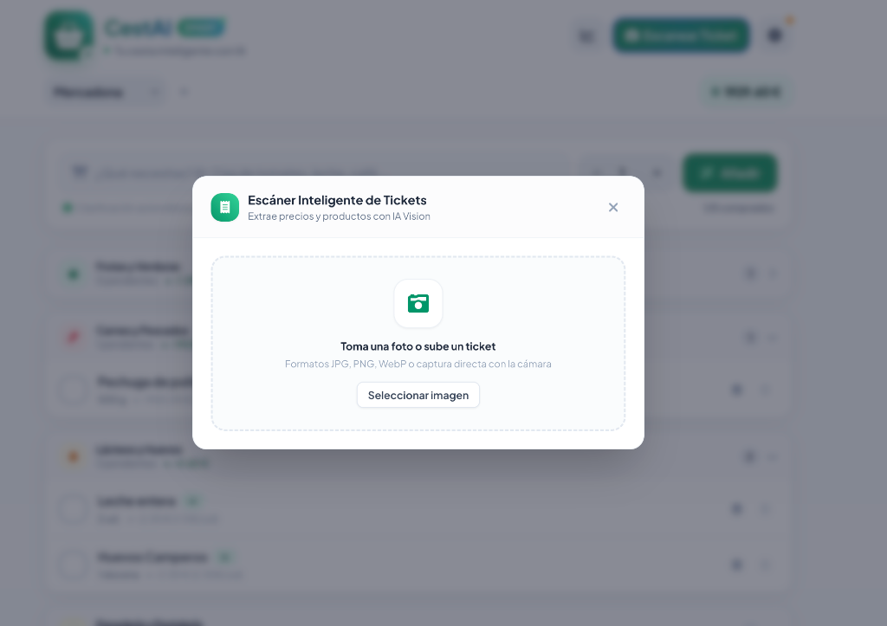
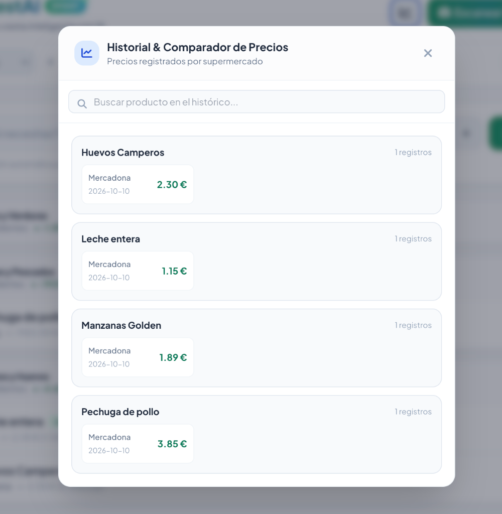
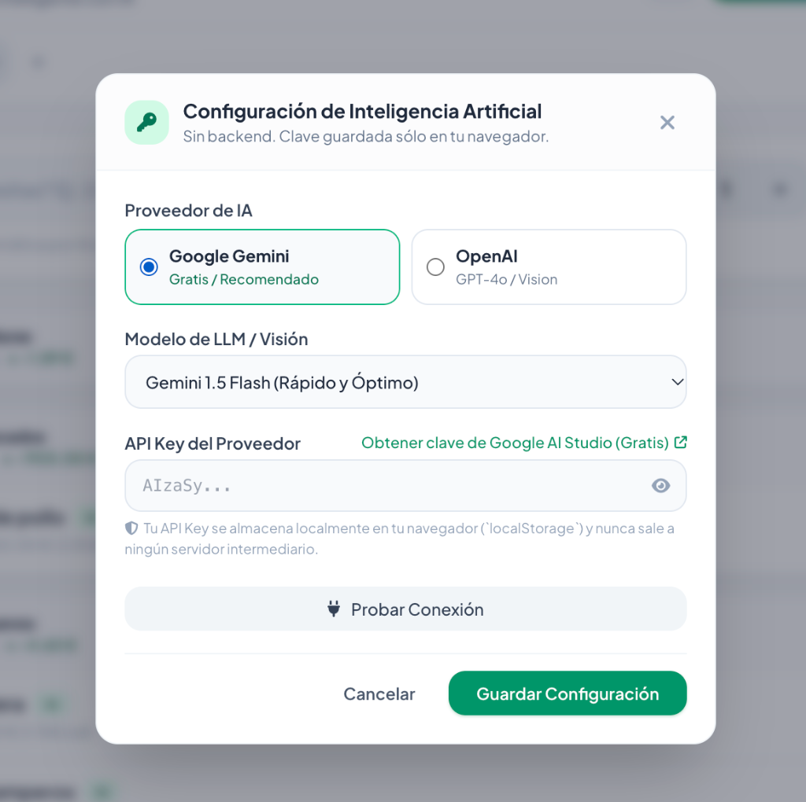

# 🛒 CestAI - Tu Cesta Inteligente con IA

<div align="center">
  

  <p align="center">
    <strong>Web App PWA Single-File para la gestión inteligente de listas de la compra con categorización por IA y escáner de tickets OCR.</strong>
  </p>

  <p align="center">
    
    
    
    
    
  </p>
</div>

---

## 🌟 Características Principales

* **Single File Application (`index.html`):** Toda la aplicación (interfaz, estilos, componentes, lógica reactiva y modelos de datos) vive en un único archivo autónomo, sin bundlers pesados ni dependencias de Node en producción.
* **Diseño Mobile-First Estilo Apple / Material:**
  * Paleta visual limpia con tonos esmeralda, bordes suaves y tarjetas redondeadas.
  * Botones y checkboxes grandes de 44px optimizados para uso táctil con una sola mano en **iPhone** y **Android**.
  * Barra flotante inferior ergonómica y soporte de *Safe Area* (*Notch* y barra inferior).
* **Clasificación Inteligente de Productos:**
  * Reconocimiento de cantidades y unidades al vuelo (ej: *"2 kg de tomates"*, *"3 bricks de leche"*).
  * Clasificación asíncrona mediante **Google Gemini** o **OpenAI**.
  * Motor heurístico offline inmediato integrado con más de 10 categorías (Frutas y Verduras, Carnes y Pescados, Lácteos, Panadería, Despensa, Pastas y Conservas, Congelados, Bebidas, Limpieza, etc.).
* **Escáner OCR de Tickets con Visión Multimodal:**
  * Captura de foto directa desde el móvil o subida de imagen.
  * Preprocesamiento y optimización de imagen en Canvas HTML5 para envíos ultrarrápidos.
  * Detección automática del supermercado, fecha, desglose de artículos y precios.
* **Fuzzy Matching Algorítmico:**
  * Cruza automáticamente mediante **Distancia de Levenshtein** y **Similitud de Tokens (Jaccard)** los nombres comerciales del ticket (ej: *"LECH ENT 1L"*) con los productos genéricos de la lista (ej: *"Leche entera"*), marcándolos como comprados y actualizando su precio.
* **Gestión de Precios e Historial por Supermercado:**
  * Selector dinámico de supermercado activo (Mercadona, Carrefour, Lidl, Dia, Alcampo o personalizados).
  * **Histórico organizado por categorías:** Visualización estructurada con las mismas categorías oficiales y acordeones plegables que la lista principal.
  * **Recompra con 1 toque (1-Tap Reorder):** Añade al instante cualquier producto habitual de nuevo a la cesta con solo tocar un botón, recordando su categoría exacta y recuperando el precio estimado sin tener que escribirlo de nuevo.
  * Estimación en tiempo real del coste total de la cesta según los precios históricos o promedio.
  * **Asignación manual de precios:** Posibilidad de tocar sobre el precio de cualquier producto o usar el botón *"Nuevo Precio"* en el comparador para ingresar ofertas en el momento.
* **Seguridad y Privacidad Absoluta (Zero Backend):**
  * Tu API Key nunca sale de tu navegador; se guarda únicamente en tu `localStorage`.
  * Copias de seguridad completas en formato **JSON** con botones de Exportar e Importar.

---

## 📱 Capturas de Pantalla

<div align="center">
  <h3>Vista Principal y Acordeones por Categoría</h3>
  
</div>

<br />

<div align="center">
  <table width="100%">
    <tr>
      <td width="50%" align="center">
        <h4>📸 Escáner OCR de Tickets con IA</h4>
        
      </td>
      <td width="50%" align="center">
        <h4>📊 Historial & Comparador de Precios</h4>
        
      </td>
    </tr>
    <tr>
      <td width="50%" align="center">
        <h4>🏪 Selector de Supermercado Activo</h4>
        
      </td>
      <td width="50%" align="center">
        <h4>⚙️ Configuración Segura de API Key</h4>
        
      </td>
    </tr>
  </table>
</div>

---

## 🚀 Inicio Rápido

### Opción 1: Abrir directamente en el navegador
Dado que es una Single File Application, puedes simplemente hacer doble clic en `index.html` o abrirlo con cualquier navegador web moderno.

### Opción 2: Servidor local ligero
Si deseas probar la experiencia como PWA o servirla en tu red local:

```bash
# Con Python 3
python3 -m http.server 3000

# Con Node / npx
npx serve -l 3000
```

Abre [http://localhost:3000](http://localhost:3000) en tu navegador.

---

## 🔑 Configuración de Inteligencia Artificial

1. Pulsa en el icono de **Ajustes (⚙️)** en la cabecera.
2. Selecciona tu proveedor preferido:
   * **Google Gemini (Recomendado y Gratuito):** Puedes obtener una API Key gratuita en [Google AI Studio](https://aistudio.google.com/app/apikey). Compatible con `gemini-1.5-flash` y `gemini-2.0-flash`.
   * **OpenAI:** Introduce tu clave de [OpenAI Platform](https://platform.openai.com/api-keys). Compatible con `gpt-4o-mini` y `gpt-4o`.
3. Haz clic en **"Probar Conexión"** para verificar el funcionamiento y luego en **"Guardar Configuración"**.

---

## 🛠️ Tecnologías Empleadas

* **HTML5 Semántico + PWA Meta Tags:** Responsive y listo para instalar en iOS (*"Añadir a pantalla de inicio"*) y Android.
* **Tailwind CSS (CDN):** Estilos minimalistas y utilidades de espaciado.
* **FontAwesome 6 (CDN):** Iconografía moderna.
* **Vanilla JavaScript ES6+:** Gestión de estado reactiva, parseo de texto libre y algoritmos de comparación difusa (*fuzzy string matching*).
* **LocalStorage API:** Persistencia persistente de ítems, supermercados, precios y configuración sin base de datos externa.

---

## 📄 Licencia

Este proyecto está bajo la Licencia MIT. Consulta el archivo de licencia para más detalles.
